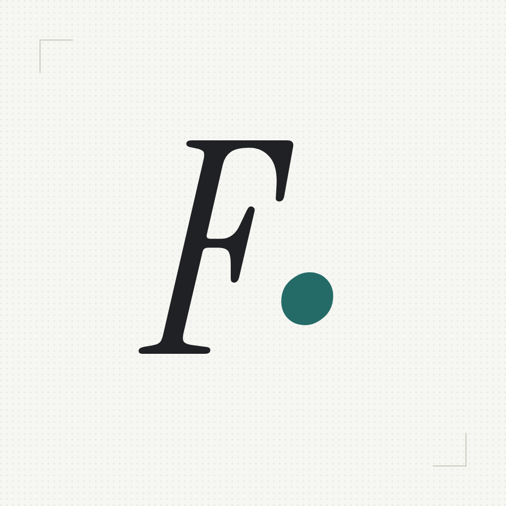

# Francis Castillo

**Frontend developer & product builder**
I design and build interfaces, products, and experiments, from idea to implementation.
Based in the Dominican Republic.

 

## Selected Work

- [**Palabreo**](https://palabreo.app) → Wordle in Spanish, with a daily challenge, timed and hard modes, and weekly leaderboards.
- [**Trace**](https://trace-olive-mu.vercel.app/) → Paste a URL and see where an article's claims come from: what it cites, what copies it, and where each claim first appeared.
- [**WebDiff**](https://webdiff-app.netlify.app/) → Compares two versions of a webpage and explains what changed in plain language.
- [**Vitalgate**](https://vitalgate.vercel.app/) → Runs Lighthouse on every pull request and blocks merges that fail Core Web Vitals.
- [**Nephrite**](https://getnephrite.dev/) → Low-glare jade color theme for browsers, VS Code and terminals.
- [**DevLinks**](https://dev-links-one-phi.vercel.app/) → A developer profile in one link: GitHub activity, articles and projects, synced automatically.
- [**Vitta**](https://vitta-log.vercel.app/) → Log your weight in five seconds and track water, steps, sleep and measurements.

## Tools I like

- Languages → Typescript, Golang
- Frontend → React, Next.js, Tanstack Start, Astro, Tailwind, Motion
- Backend → Node.js, Hono, tRPC, PostgreSQL, Neon, Drizzle ORM, Payload, Better Auth
- Design → Figma, Photoshop
- Infra → Vercel, Cloudflare, Docker, GitHub Actions

  
  
  
  

  
  
  

  

 

  <b>Have an idea worth building?</b> <a href="mailto:contacto@franciscode.dev">Say hello.</a>

